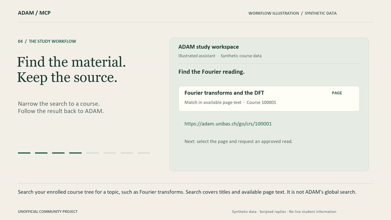

# ADAM MCP

[](https://github.com/Arudchayan/adam-mcp/actions/workflows/ci.yml)

ADAM MCP connects MCP-compatible AI clients to your University of Basel ADAM courses.

It runs on your machine. Cursor, Claude Desktop, VS Code Copilot, Windsurf, Claude Code, the ChatGPT desktop app, Codex CLI, and the Codex IDE extension can list courses, read pages, find files, and surface deadlines from ADAM.

This is a community project, not a University of Basel service.



[YC marketing demo (~90s, chat UX)](docs/demo/adam-mcp-demo-yc.mp4) · [Legacy Inspector cut](docs/demo/adam-mcp-demo.mp4)

## What you can ask

- Show timestamped course news from this week.
- What deadlines do I have?
- Find the exercise sheet about Fourier transforms.
- Summarize this course page and give me the ADAM link.
- List the material available for this course.

Answers include canonical ADAM URLs (`https://adam.unibas.ch/go/...`).

## Quick start

You need Node.js 20+ and Google Chrome.

Install from this repository today. Guided setup checks your installation, configures one client with a backup, opens Chrome for sign-in, and verifies your course listing.

```bash
git clone https://github.com/Arudchayan/adam-mcp.git
cd adam-mcp
npm install
npm run setup -- --client codex --write --login
```

Replace `codex` with `cursor`, `claude-desktop`, `windsurf`, or `vscode`. For VS Code, supply `--output` with the intended workspace's `.vscode/mcp.json` path. Restart your client, enable **adam**, then ask: **What courses am I in? Include their ADAM links.**

Preview without changing settings: `npm run setup -- --client codex`. Diagnose a connection: `npm run doctor -- --client codex`. Credentials stay in the Chrome sign-in window. Setup never asks for them in the terminal or chat.

See [client compatibility](docs/client-compatibility.md) for what has been verified and [the setup guide](docs/setup.md) for manual configuration, backups, and recovery.

### From the registry (after publish, untested until publish)

The package ships a self-contained CLI. Once a reviewed version is published:

```bash
npx -y adam-mcp
# or
npm install -g adam-mcp
adam-mcp
```

Default is live ADAM. For a registry installation, run `adam-mcp login` once, then start the server (see [docs/setup.md](docs/setup.md)). `--browser` is optional.

### Clone (default tested path: setup helpers + host snippets)

```bash
git clone https://github.com/Arudchayan/adam-mcp.git
cd adam-mcp
npm install
npm run setup
```

Without a client argument, interactive setup asks which client to use; noninteractive setup prints all supported snippets. Setup previews by default. Add `--write` to install the selected configuration with a backup, and `--login` to sign in and verify courses.

- **Your real courses:** paste the snippet from `npm run setup`, then `npm run login` and sign in to ADAM in Chrome. The window closes automatically; the session continues headless. After login, check `adam_session_status`, then call `adam_list_courses` (cold-start: always re-check status after login before listing).

Restart the client, then ask:

> What courses am I in? Include the ADAM URL for each.

Login reuses a valid session without opening Chrome. Close the sign-in window or
press Ctrl+C to cancel; failed attempts close their window. Use
`npm run login -- --force` for a fresh window, or `npm run login -- --timeout-ms 120000` for a
two-minute sign-in wait. `npm run logout` stops the local session and disables
automatic reconnection until explicit login. `npm run logout -- --purge` also
removes the dedicated profile; local logout does not sign you out of SWITCH in
other browsers.

Host-specific files (Cursor, Claude Desktop, VS Code, Windsurf, Claude Code, ChatGPT desktop, Codex): [docs/setup.md](docs/setup.md).

## How it works

```
AI client  --stdio MCP-->  adam-mcp  -->  Chrome session  -->  adam.unibas.ch
```

ADAM MCP uses a local Chrome session for ADAM authentication. The default runtime is live ADAM.

[Architecture](docs/architecture.md) · [What is in scope](docs/scope.md) · [Capabilities](docs/capabilities.md) · [Roadmap](docs/ROADMAP.md)

## Tools

| Tool | Returns |
| --- | --- |
| `adam_list_courses` | Enrolled courses and ADAM URLs |
| `adam_get_course` / `adam_list_children` | Course snapshot and folder contents |
| `adam_read_page` | Page text (`confirm: true` OR elicitation) |
| `adam_list_files` / `adam_get_file` | File metadata and URLs, not bytes |
| `adam_extract_file_text` | Local PDF/text extract (`confirm: true` OR elicitation) |
| `adam_search` | Title matches in enrolled objects |
| `adam_list_calendar` / `adam_list_news` | Dates and news from pages you can see |
| `adam_get_exercise` | Exercise text and deadline (`confirm: true` OR elicitation); no submit |
| `adam_get_forum` | Forum meta and thread summaries; post bodies need `confirm: true` OR elicitation; no post/reply |
| `adam_login` / `adam_session_status` | Chrome session in the live runtime |

Document and thread text requires approval for the selected object. Your connected model receives the returned text. See [tool contracts](docs/tool-contracts.md) for confirmation, pagination, recovery and completeness rules.

Confirm contract: pass confirm:true OR approve elicitation; hosts without elicitation require confirm:true; decline/cancel → same confirmation_required, no data; forum needs gate only with threadId.

## Limitations

- No writes, mail, grades, or exam (`tst`) objects.
- Search is not ADAM’s global search box. Dates are not the ILIAS calendar GUI.
- Scanned PDFs are not OCR’d.
- Supported PDFs are parsed by actual page, with an 8 MiB transfer cap, 40,000
  text characters, and at most 20 pages (default eight). Empty/malformed files
  fail closed. Formula interpretation and exact visual layout are not guaranteed.
- Course pages and complete cross-course walks refresh after one minute. Restart
  the MCP server for an immediate refresh. Existing pagination retains its
  original snapshot for ten minutes; expired cursors require restarting the list.
- Cross-course reads have a two-minute elapsed budget and report partial results
  when reached. The browser queue admits at most 32 waiting operations and limits
  waiting to 30 seconds. Cancelling a request releases its work when nobody else
  needs it; cached reads reuse navigation and parsing.
- Search, calendar and news accept an enrolled `courseRefId` to narrow discovery. Use `refresh: true` without a cursor for fresh results. `snapshotAt` identifies the listing snapshot; each item's provenance records when it was fetched. Partial results include coverage reasons.
- News with a cutoff includes only items with a known timestamp. Undated news
  remains visible without a cutoff. This does not compare file inventories;
  no matching news is not proof that nothing changed.
- Deadline clock times without an offset use Europe/Zurich. Ambiguous or invalid
  dates/times are omitted. Date-only evidence uses UTC midnight as a representation,
  and does not establish a midnight deadline.

## Privacy

Tool results go to the model your client is already using. Course content is copyrighted.

[SECURITY.md](SECURITY.md) · [threat model](docs/threat-model.md)

## Develop

```bash
npm test
npm run typecheck
npm run check  # tests, typecheck, build, built-package verification, dependency audit
npm run release:check  # also verifies a clean tarball installation
npm run benchmark:reads  # synthetic cached-read timing; no live ADAM access
```

[CONTRIBUTING.md](CONTRIBUTING.md) · [AGENTS.md](AGENTS.md)

License: GPL-3.0-or-later.
